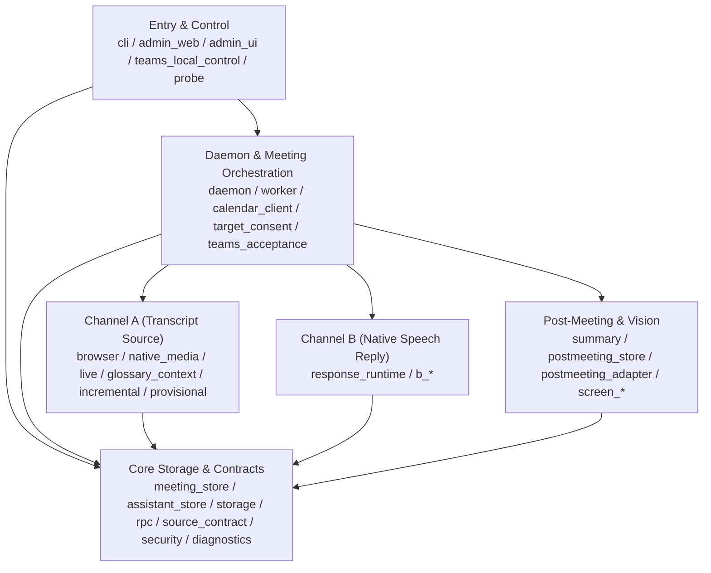

# 架構分層與邊界地圖

本文件整理 `teams_transcription/` 的模組分層、允許依賴方向，以及哪些契約由 **程式靜態／測試閘門直接阻擋**、哪些由 **規範文件與獨立審查**把關。細節規範仍以 [AGENTS.md](../AGENTS.md) 與各專題文件（[HANDOFF.md](HANDOFF.md)、[B-LIVE-NATIVE.md](B-LIVE-NATIVE.md)、[MEETING-STORE.md](MEETING-STORE.md)、[SUMMARY-RUNTIME.md](SUMMARY-RUNTIME.md)）為準。

## 模組分層圖



## 模組歸屬與依賴方向

| 層級 | 代表模組 | 允許依賴 | 禁止依賴 |
| --- | --- | --- | --- |
| Entry / Control | `__main__.py`, `cli.py`, `admin_web.py`, `admin_ui.py`, `teams_local_control.py`, `web_authorization.py`, `probe.py` | Orchestration, Core, Service | 不把背景狀態留在 HTTP request / 瀏覽器分頁 |
| Orchestration | `daemon.py`, `worker.py`, `calendar_client.py`, `calendar_readback.py`, `calendar_view.py`, `occurrence_window.py`, `target_consent.py`, `teams_acceptance.py`, `rx_contract.py` | Core, Channel A, Channel B, Post-Meeting | — |
| Channel A（轉錄來源） | `native_media.py`, `live.py`, `incremental.py`, `provisional.py`, `glossary_context.py`, `browser.py` | Core, `rx_audio_stats`, `b_document_policy` | **不得 import B 回覆模組**（`response_runtime`, `b_native*`, `b_live`, `b_browser_tx`, `b_question*`, `b_context`, `b_response`） |
| Channel B（語音回覆） | `response_runtime.py`, `b_native.py`, `b_native_output.py`, `b_live.py`, `b_browser_tx.py`, `b_question.py`, `b_context.py`, `b_response.py`, `b_no_plc*.py`, `b_media_profile.py`, `b_guard.py`, `b_echo.py`, `b_audio.py` | Core（經 `meeting_store` 只讀寫授權範圍）, `browser`, `b_document_policy` | **不得 import A 轉錄寫入鏈或 UI／CLI／daemon／worker**（`live`, `incremental`, `provisional`, `native_media`, `admin_*`, `cli`, `daemon`, `worker`） |
| Post-Meeting & Vision | `summary.py`, `postmeeting_store.py`, `postmeeting_adapter.py`, `task_workflow.py`, `screen_capture.py`, `screen_vision.py`, `screen_watcher.py` | Core | UI / CLI / daemon / worker |
| Core & Security | `meeting_store.py`, `assistant_store.py`, `storage.py`, `rpc.py`, `source_contract.py`, `security.py`, `diagnostics.py`, `runtime_guard.py`, `history_context.py`, `provider_state.py`, `assistant_config.py` | 同層與底層純契約模組 | UI / CLI / daemon / worker |

## 檢查分層：程式先擋 vs 規則與審查

1. **程式檢查直接阻擋（[.devflow/check.sh](../.devflow/check.sh) + [.devflow/check.py](../.devflow/check.py) + `.devflow/rules/*.toml` + `devflow preflight`）：**
   - 架構隔離：`a-b-isolation`、`b-no-a-write-or-ui`、`core-no-ui-cli`。
   - 安全硬邊界：`no-unsafe-browser-sandbox`（禁止 `--no-sandbox`、`CAP_SYS_CHROOT`／`SYS_CHROOT`、`privileged: true`）。
   - 測試與品質紀律：`no-skip-test`、`no-sleep-fix`、`no-suppress`（舊碼以 `.devflow/rules/baseline.json` 記錄，只擋新增）。
   - 變更護欄：`pr-diff-budget`（單 PR 最多 35 個檔案、2000 新增行，排除 lock/baseline/check.py/docs/evidence），並在 `pull_request` 事件由 `.devflow/check.sh` 自動執行 `check.py --pr`。
   - 教訓與契約：`lessons/L-*.toml` schema 驗證、`git diff --check`、`compileall`、`tools/check_repo_skills.py`、目標單元測試、`diagnostics_proof.py` 與 `check_pr_proof.py`。
2. **文件規則與獨立審查把關（[AGENTS.md](../AGENTS.md) + `paulpai0412` Review）：**
   - 交易內 lease fence（`MeetingStore._locked`）、await 後重查停止與撤權狀態、B 真實來源 quiet vs render quiet 區分。
   - 真實會議／OAuth／部署／權限變更需明確人工或執行步驟驗證，不以合成測試外推真人聽感。
   - CI 隔離與可信來源（不從 PR head 跑特權 `pull_request_target`）。

## 開發者／Agent 檢查速查

```bash
# 執行完整規則自測、教訓驗證與新增違規掃描
python3 .devflow/check.py

# 執行完整 check.sh 閘門
bash .devflow/check.sh
```

- 僅在確有必要且不可避（例如外部限流退避）時使用行內豁免：`# devflow: allow <rule-id> L-NNNN`，並補寫對應 `.devflow/lessons/L-NNNN.toml`。
- 若重構後刻意新增模組邊界規則，請同步更新對應 `.devflow/rules/*.toml`（附 `expect = "fail"` 與 `expect = "pass"` `[[fixture]]`）與本文件。
